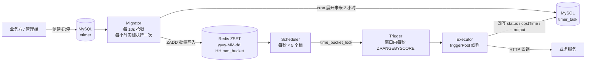

# bitstorm 定时任务平台（xtimer）

多机安全、秒级精度、业务零侵入的轻量定时任务平台。

业务方只需要注册一个 HTTP 回调地址，平台负责「什么时候跑、谁来跑、跑没跑成功」；
管理端（`xtimer-admin`）提供定时器的创建、启停、执行记录查询。

---

## 一、项目介绍

### 1.1 为什么要做这个项目

团队有多个项目都带定时业务（库存预热、订单对账、抽奖池补货、缓存刷新等）。原先的实现方式是各业务服务里直接写 Spring 的 `@Scheduled` 注解：

```java
@Scheduled(cron = "0 0 9 * * ?")
public void preheat() { ... }
```

单机部署时没问题，但随着项目演进，暴露了三个绕不过去的问题：

1. **多机部署会重复执行。** 有一个项目是双机部署，`@Scheduled` 只懂「到点就跑」，两台机器各跑一次。
   对于对账、库存扣减这类操作，重复执行直接导致数据不一致，而且排查时很难复现——取决于哪台机器先启动、GC 什么时候停顿。
2. **没有重试。** 回调失败就是失败，业务方只能等下一次调度，或者人工补数据。`@Scheduled` 本身不提供执行记录，失败了连「失败过几次」都查不到。
3. **没有统一视图。** 任务散落在各个服务的代码里，要知道「系统里现在有哪些定时任务、各自什么时候跑、昨天有没有失败」，只能逐个服务翻日志。

### 1.2 为什么不用 xxl-job

评估过 xxl-job，结论是不合适，原因不是它不好，而是**能力与诉求不匹配**：

| 维度 | 我们的诉求 | xxl-job |
| --- | --- | --- |
| 使用方式 | 业务代码不想改 | 需要引入依赖、实现 `IJobHandler`，任务逻辑和执行框架绑在一起 |
| 功能范围 | 只需要「定时执行 + 失败重试」 | 任务编排、分片广播、GLUE 脚本、调度报表、多执行器路由等 |
| 接入成本 | 一个回调地址 | 接入执行器、配置注册中心、理解调度中心模型 |

对我们来说，xxl-job 里大部分能力永远用不到，却要长期承担它的部署与维护成本。而且它和业务代码耦合偏高——任务逻辑写在实现类里，想从 A 服务搬到 B 服务，代码得一起搬。

所以决定自研。目标很克制：**把「定时」这件事从业务服务里彻底剥离出来，做成一个只认 HTTP 回调的基础设施。**

### 1.3 设计目标

| 目标 | 实现方式 |
| --- | --- |
| 多机部署下同一任务只执行一次 | Redis 分布式锁 + 任务状态校验 + 数据库唯一键三重保障 |
| 秒级精度 | 分钟时间桶 + 窗口内每秒扫描 |
| 业务零侵入 | 只回调 HTTP 接口，业务方不需要引入任何 SDK |
| 执行结果可观测 | 计划时间、实际耗时、状态、响应原文全部落库 |
| 可水平扩展 | 无状态多实例，按时间桶与桶号切片，加机器即扩容 |
| 失败可重试 | 上一分钟批次重放 + 锁超时未续期机制 |

### 1.4 能力边界（诚实的部分）

- 只支持 HTTP 回调，目前 `ExecutorWorker` 仅实现了 POST 分支，GET/PUT/DELETE 会走空分支（见「已知限制」）。
- 单任务单次触发，不支持 DAG 依赖、任务编排、分片广播。
- 重试是「批次级重放」，不是「单任务精确重试 N 次」。
- cron 由 Quartz 的 `CronExpression` 解析，支持秒级字段。

---

## 二、技术架构

### 2.1 在工程中的位置

| 模块 | 职责 |
| --- | --- |
| `bitstorm-svr-api` | 对外 DTO 与 Feign 接口（`TimerDTO`、`NotifyHTTPParam`、`XTimerClient`） |
| `bitstorm-svr-common` | 统一响应体 `ResponseEntity`、`ReentrantDistributeLock`、基础模型 |
| `bitstorm-svr-gateway` | 网关 :10001，统一入口与路由 |
| `bitstorm-svr-xtimer` | **定时任务平台本体**，:8082 |
| `xtimer-admin` | Vue 3 管理端（定时器管理、执行记录） |

### 2.2 四段式执行链路

任务从「一条 cron 配置」到「一次 HTTP 回调」，拆成四个职责单一的阶段，每段只做一件事：



| 阶段 | 核心类 | 触发频率 | 存储介质 | 关键动作 |
| --- | --- | --- | --- | --- |
| 迁移 Migrator | `MigratorWorker` + `MigrateManagerImpl` | 每 10s 尝试抢锁，按小时维度互斥 | MySQL → MySQL + Redis | 用 cron 展开未来 2 小时的执行时间点，批量落库并写入 ZSET |
| 调度 Scheduler | `SchedulerWorker` + `SchedulerTask` | 每秒 | Redis 锁 | 遍历 5 个桶，对「当前分钟」和「上一分钟」发起异步处理 |
| 触发 Trigger | `TriggerWorker` + `TriggerTimerTask` | 窗口内每秒 | Redis ZSET → MySQL 降级 | 按秒切片捞取待执行任务，投递给执行线程池 |
| 执行 Executor | `TriggerPoolTask` + `ExecutorWorker` | 任务队列驱动 | MySQL | 幂等校验 → 状态校验 → HTTP 回调 → 回写结果 |

### 2.3 数据模型

**`xtimer`（定时器定义）**

| 字段 | 说明 |
| --- | --- |
| `timer_id` | 主键 |
| `app` | 所属业务，管理端按此隔离 |
| `name` | 任务名称 |
| `status` | 0 新建 / 1 未激活 / 2 已激活（以 `TimerStatus` 枚举为准） |
| `cron` | Quartz cron 表达式 |
| `notify_http_param` | 回调配置 JSON：`{method, url, header, body}` |

**`timer_task`（执行实例）**

| 字段 | 说明 |
| --- | --- |
| `task_id` | 主键 |
| `timer_id` | 所属定时器 |
| `run_timer` | 计划执行时间（毫秒时间戳） |
| `status` | 0 未运行 / 1 运行中 / 2 成功 / 3 失败 |
| `cost_time` | 实际耗时（毫秒） |
| `output` | 回调响应原文 / 异常信息 |
| `(timer_id, run_timer)` | **唯一键**，防重复插入的最后一道防线 |

**Redis ZSET 键设计**

```
key    = "2026-10-22 17:30_3"        // 分钟桶_桶号（桶号 = timerId % bucketsNum）
member = "1001_1792661400000"        // timerId_计划执行时间戳
score  = 1792661400000               // 计划执行时间戳，供 ZRANGEBYSCORE 按秒取
```

`member` 里冗余了 `timerId` 与时间戳，所以从 ZSET 捞出来的数据可以直接构造任务对象，不必回查数据库。

### 2.4 关键设计

**① 冷热分离：只物化未来 2 小时的任务**

`MigrateManagerImpl.migrateTimer` 不把 cron 展开成「永久」的任务表，只生成 `[now, now + 2 × migrateStepMinutes]`（当前配置 60 分钟，即 120 分钟）区间内的执行点。
一个月跑一次的任务，数据库里始终只有未来一到两个待执行实例，任务表不会随时间无限膨胀。

**② 按桶横向切分**

```
bucketId = timerId % bucketsNum          // 当前配置 bucketsNum = 5
zsetKey  = yyyy-MM-dd HH:mm + "_" + bucketId
lockKey  = "time_bucket_lock_" + yyyy-MM-dd HH:mm + "_" + bucketId
```

定时器被打散到 5 个桶，锁的粒度精确到「分钟 + 桶」，所以同一时刻最多 5 个分片并行推进，互不阻塞；扩容只需要加实例，抢不到锁的实例自动空转。

**③ 三层幂等**

| 层次 | 手段 |
| --- | --- |
| 写入 | `INSERT IGNORE` + `(timer_id, run_timer)` 唯一键，重复迁移不会产生重复任务 |
| 消费 | `ExecutorWorker` 先查任务状态，非 `NotRun` 直接 return |
| 状态 | 回调前二次确认定时器仍为「已激活」，用户暂停后立即生效 |

**④ 锁只加不解**

所有锁都不主动释放，只靠 TTL 过期——避免「A 的锁被 B 误删」这类经典问题，同时用 TTL 天然实现了频率限制（创建/启停操作 3 秒内只允许一次）。

### 2.5 技术栈

| 层次 | 选型 |
| --- | --- |
| 语言 / 运行时 | Java 8（`maven.compiler.target` = 1.8） |
| 框架 | Spring Boot 2.7.7、Spring Cloud 2021.0.5、Spring Cloud Alibaba 2021.0.4.0 |
| 服务治理 | Nacos（注册 + 配置）、Spring Cloud Gateway、OpenFeign |
| 存储 | MySQL 8（MyBatis）、Redis 7（ZSET + 分布式锁 + Lua） |
| 定时解析 | Quartz `CronExpression` |
| 管理端 | Vue 3 + TypeScript + Vite 5 + Element Plus |

---

## 三、技术难点

### 3.1 高精准：怎么做到「到点就跑、只跑一次」

**难点一：跨机器的时间精度**

单机的 `ScheduledExecutorService` 精度够，但多机部署后不能指望某台机器的本地定时器。
做法是把「时间」变成可切片的外部状态：

- 迁移阶段把执行点写进 Redis ZSET，`score` 就是计划执行时间戳；
- 调度阶段每秒遍历桶，对每个桶加 `time_bucket_lock_{分钟}_{桶号}`；
- 触发阶段在**一分钟窗口内每秒**执行一次 `ZRANGEBYSCORE key [t, t+1s)`，只捞当前这一秒该跑的任务。

时间片是数据，不是内存里的定时器状态，所以任何一台机器都能接手任意一个时间片。

**难点二：漏执行与重复执行的取舍**

分布式环境下，「不漏」和「不重」天生冲突，这里的策略是**宁可重复投递，靠幂等兜底**：

- `SchedulerWorker` 每一轮不只处理「当前分钟」，还会**重放上一分钟**的批次。机器时钟回拨、上一次分片执行异常、线程池打满被拒绝，都能在这个重放窗口里补上。
- 重放会不会导致重复执行？靠锁的续期策略控制：
  - 分片**执行成功** → `expireLock` 把锁从 70s 延长到 130s，下一分钟的重放抢不到锁，自然不重复；
  - 分片**执行失败** → 不续期，锁在 70s 后过期，下一分钟的重放能抢到锁，完成重试。

这把「是否重试」编码进了锁的生命周期，比额外维护一张重试表简单得多，也避免了重试表本身的一致性问题。

**难点三：消费端必须幂等**

即使投递重复，也不能重复回调业务。`ExecutorWorker.work` 的第一件事就是查任务：

```java
TaskModel task = taskMapper.getTasksByTimerIdUnix(timerId, unix);
if (task.getStatus() != TaskStatus.NotRun.getStatus()) {
    log.warn("重复执行任务： timerId" + timerId + ",runtimer:" + unix);
    return;
}
```

回调前还会重新查一次定时器状态，确认仍是「已激活」——用户点了暂停之后，已经进入队列的任务不会再打出回调。

**难点四：一分钟窗口必须跑完才退出**

`TriggerWorker` 用 `java.util.Timer` 每 1 秒驱动 `TriggerTimerTask`，并用 `CountDownLatch` 阻塞等待：只有推进到窗口末尾（`tStart > endTime`）才 `countDown()`。
这样「一分钟的任务」和「一分钟的扫描周期」严格对齐，不会出现这一分钟的尾巴被下一轮重复处理。

### 3.2 高负载：怎么扛住任务量增长

**① 写放大被冷热分离掐住**

不做全量物化，每次迁移只写 2 小时窗口。10 万个定时器 × 每分钟一次，也只会产生 120 分钟内的任务实例，而不是几十万条永久记录。

**② 批量写 + 事务批提交**

- MySQL：一次 `batchSave` 写入整批执行点，`INSERT IGNORE` 让重复迁移变成空操作；
- Redis：`SessionCallback` + `multi/exec`，一批执行点在一个事务里完成 `ZADD`，避免逐条往返。

**③ 读写分离的降级路径**

`TriggerTimerTask.getTasksByTime` 优先走 Redis ZSET；只有缓存异常时才降级到 `taskMapper.getTasksByTimeRange`。
热路径（每秒）几乎不碰 MySQL，MySQL 只承担迁移写入和结果回写。

**④ 线程池隔离与背压**

| 线程池 | 用途 | 核心 / 最大 / 队列 |
| --- | --- | --- |
| `schedulerPool` | 分片调度（每桶每分钟一个任务） | 10 / 100 / 99999 |
| `triggerPool` | 任务投递到 Executor | 10 / 100 / 99999 |

两个池子互不干扰：调度被拖慢不会阻塞触发，触发被阻塞不会影响下一分钟的调度。
拒绝策略统一用 `CallerRunsPolicy`——队列打满时由调用线程自己执行，形成天然背压，而不是静默丢任务。

**⑤ 锁竞争随规模线性摊薄**

锁 key 里带分钟和桶号，5 个桶意味着每秒最多 5 个分片争抢、且各自抢的是**不同 key**。
实例数从 1 加到 10，锁竞争不会变成 10 倍——多出来的实例大部分时间在空转（抢不到锁），这是有意的设计：**用一点空转换取无状态扩展能力**。

**⑥ 关键参数**

| 参数 | 当前值 | 作用 |
| --- | --- | --- |
| `scheduler.bucketsNum` | 5 | 桶数量，决定并行分片上限 |
| `scheduler.tryLockSeconds` | 70 | 首次抢锁后的 TTL，略大于一分钟 |
| `scheduler.successExpireSeconds` | 130 | 执行成功后延长到的 TTL，覆盖下一分钟的重放窗口 |
| `trigger.zrangeGapSeconds` | 1 | 窗口内扫描步长（秒） |
| `migrator.migrateStepMinutes` | 60 | 迁移步长，实际窗口 = 2 × 60 = 120 分钟 |

### 3.3 已知限制与优化方向

这些是当前实现里真实存在的短板，写在这里而不是藏起来：

| 问题 | 影响 | 方向 |
| --- | --- | --- |
| `ExecutorWorker` 的 `switch` 只有 POST 分支 | 配置 GET/PUT/DELETE 会拿到 null 响应并 NPE | 补齐分支 + 统一用 `RestTemplate.exchange` |
| ZSET 没有 TTL 清理 | 桶 key 只增不减，长期运行内存持续上涨 | 桶处理完成后按分钟粒度过期，或异步清理历史桶 |
| 调度每秒全桶空扫 | 5 桶 × 2 批次 = 10 次/秒，即使没有任务也在扫 | 空桶短路：先 `ZCARD` 判断再决定是否启动触发器 |
| `ExecutorWorker` 用同步 `RestTemplate` | 回调慢时占满 `triggerPool` 线程 | 换 WebClient / OkHttp 异步，或按业务隔离线程池 |
| 迁移每 10s 抢锁、实际每小时一次 | 多实例下产生无意义的锁竞争日志 | 改为按小时对齐触发，抢锁前先判断是否已迁移 |
| 回调无超时与重试次数控制 | 单次回调失败只能等批次重放 | 增加单任务重试计数与退避策略 |

---

## 四、快速开始

### 后端

```bash
# 1. 初始化数据库
mysql -uroot -p < db/bitstorm-svr-xtimer.sql

# 2. 准备配置（仓库不包含真实口令，需从示例文件复制后填写）
cp bitstorm-svr-xtimer/src/main/resources/application-example.yml \
   bitstorm-svr-xtimer/src/main/resources/application.yml
# 同样的方式为需要启动的模块（gateway 等）生成 application.yml，填入本地 MySQL / Redis / Nacos 口令

# 2. 启动 Nacos（注册中心与配置中心依赖）
#    默认地址 127.0.0.1:8848，见 bitstorm-svr-xtimer/src/main/resources/application.yml

# 3. 编译并在项目根目录启动
mvn clean install -DskipTests
java -jar bitstorm-svr-xtimer/target/bitstorm-svr-xtimer-*.jar    # :8082
java -jar bitstorm-svr-gateway/target/bitstorm-svr-gateway-*.jar  # :10001
```

依赖：JDK 8+、Maven 3.6+、MySQL 8、Redis 7、Nacos 2.x。

### 管理端

```bash
cd xtimer-admin
npm install
npm run mock   # 可选：接口未就绪时用本地 stub（:8082）
npm run dev    # http://localhost:5173
```

管理端通过 `/xtimer/**` 代理直连 xtimer 服务 8082，详细说明见 [xtimer-admin/README.md](xtimer-admin/README.md)。

---

## 五、目录结构

```
bitstorm-java-project-241010/
├── bitstorm-svr-api/          # DTO 与 Feign 接口
├── bitstorm-svr-common/       # 统一响应、分布式锁
├── bitstorm-svr-gateway/      # 网关 :10001
├── bitstorm-svr-xtimer/       # 定时任务平台
│   └── src/main/java/cn/bitoffer/xtimer/
│       ├── service/migrator/  # 迁移：cron → 任务实例
│       ├── service/scheduler/ # 调度：分钟桶 + 分片锁
│       ├── service/trigger/   # 触发：秒级扫描 ZSET
│       ├── service/executor/  # 执行：HTTP 回调 + 结果回写
│       ├── redis/TaskCache    # ZSET 读写
│       └── common/conf/       # 各阶段参数
├── bitstorm-svr-{seckill,lottery,mqtry,leaf,...}/  # 其他业务模块
├── db/                        # 建表脚本
└── xtimer-admin/              # Vue 3 管理端
```

---

## 六、接口与状态字典

核心接口（`XtimerWebController`，前缀 `/xtimer`）：

| 方法 | 路径 | 说明 |
| --- | --- | --- |
| POST | `/createTimer` | 创建定时器，返回 `timerId` |
| GET | `/enableTimer?app=&timerId=` | 激活并触发一次迁移 |
| GET | `/getAppTimers?app=` | 查询应用下定时器 |

统一响应体：`{code, message, datetime, data}`，`code = 0` 表示成功。

状态字典以枚举为准：

- `TimerStatus`：1 = 未激活，2 = 已激活
- `TaskStatus`：0 = 未运行，1 = 运行中，2 = 成功，3 = 失败

> 注：`db/bitstorm-svr-xtimer.sql` 里 `status` 字段的注释（0 新建 / 1 激活 / 2 未激活）与枚举方向相反，以代码枚举为准，DDL 注释待修正。

---

## 七、管理端页面实现效果

管理端基于 Vue 3 + TypeScript + Element Plus，用两个页面覆盖「配置」与「观察」两条主线：在页面里把定时器配出来，再在执行记录里确认它是不是按预期跑了。
以下截图来自本地运行的实例（数据由 `xtimer-admin/mock` 提供，接口契约与真实服务一致）。

### 7.1 定时器管理


- 支持按 **app / 状态 / 名称** 组合筛选，分页查询
- 状态列直接体现定时器是否在跑（运行中 / 未激活），避免把「配置好了」误当成「已经在跑」
- 行内操作：编辑、启用 / 暂停、删除。启停走分布式锁，重复点击会被后端频率限制拦住；删除有二次确认

### 7.2 新建 / 编辑定时器


- **Cron 助手**：8 个常用预设（每分钟 / 每小时 / 每天 0 点 / 每周一 9 点……）一键填充，输入时实时校验合法性，并预览接下来三次执行时间；支持 Quartz 的 6 位与 7 位写法，`?` 占位符做了兼容转换
- **回调配置**：方法（POST / GET / PUT / DELETE）、地址、Header 动态增删、Body JSON 校验，直接对应 `NotifyHTTPParam` 的四个字段
- 编辑时应用标识锁定不可改，避免把已有任务「搬」到别的 app 下产生孤立执行记录

### 7.3 执行记录


- 按应用、定时器 ID、执行状态、时间范围筛选，直接查 `timer_task`
- 四列对应底层字段：计划执行时间 `run_timer`、耗时 `cost_time`、状态 `status`、输出 `output`
- 失败任务标红，输出列可点击查看完整响应原文——这正是原先 `@Scheduled` 方案里完全缺失的能力：出了问题不用再去翻各服务日志

